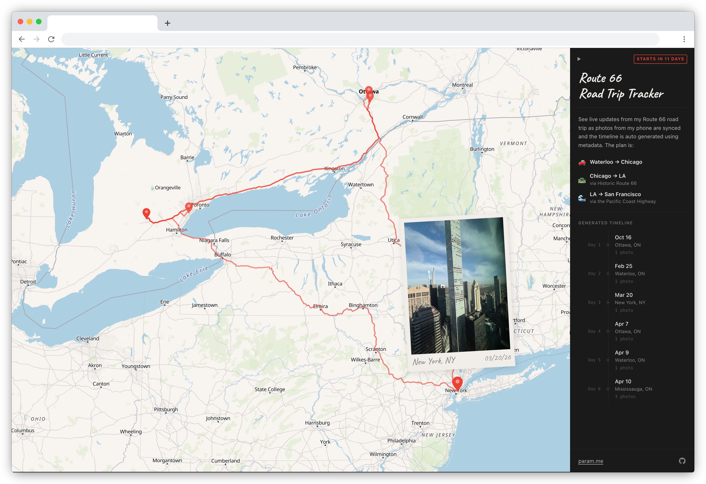

# Trip Tracker

> An interactive map tracker for road trips, built on GPS-tagged photos

Drop in your photos and get an interactive map with polaroid popups, an interpolated route, a day-by-day timeline, and live trip status. [Set it up for your own trip!](#set-up-for-your-own-trip)





Built with React + MapLibre GL JS + OpenFreeMap tiles

## Set up for your own trip

### 1. Use this template

Click **Use this template → Create a new repository** on GitHub.

### 2. Enable GitHub Pages

Go to your repo's **Settings → Pages** and set the source to **GitHub Actions**.

### 3. Add your OpenRouteService API key

Sign up for a free key at [openrouteservice.org](https://openrouteservice.org/), then add it as a repository secret named `ORS_API_KEY` under **Settings → Secrets and variables → Actions → New repository secret**.

This is used to snap your route to actual roads. Without it, the map falls back to straight lines between photos.

### 4. Update `src/trip.config.js`

Set `BASE_PATH` to where your site is served — `'/your-repo-name/'` for a GitHub Pages project site, or `'/'` for a custom domain at the root. Everything else is optional: trip dates, title, map style, sidebar links.

### 5. Add your photos

**Option A — commit photos directly (default)**

Drop GPS-tagged photos (JPG, HEIC, or PNG) into `public/photos/` and push to `main`. Any photo taken on a modern iPhone or Android with location enabled will have GPS data.

GitHub Actions handles the rest automatically: it extracts EXIF metadata, generates thumbnails, fetches the road-snapped route, builds the site, and deploys it to GitHub Pages. The route also re-fetches hourly in case ORS was temporarily unavailable.

**Option B — sync from Google Drive**

If you'd rather upload photos to a Google Drive folder than commit them to the repo, you can connect the tracker to a Drive folder. An hourly cron will pull new photos, process them, and redeploy automatically.

1. Create a [GCP service account](https://console.cloud.google.com/iam-admin/serviceaccounts) and download a JSON key for the account.
2. Enable the [Google Drive API](https://console.cloud.google.com/apis/api/drive.googleapis.com) for the same GCP project.
3. Share your Drive folder with the service account's email address (Viewer access is enough). No IAM roles are needed — Drive access is controlled by folder sharing, not GCP permissions.
4. Add two more entries under **Settings → Secrets and variables → Actions**:
   - Secret `GOOGLE_SERVICE_ACCOUNT_JSON` → paste the full contents of the JSON key file
   - Variable (not secret) `GOOGLE_DRIVE_FOLDER_ID` → the folder ID from its URL (`drive.google.com/drive/folders/<ID>`)

The hourly `sync-drive` workflow downloads any new photos from Drive, commits them to `public/photos/`, and pushes — which triggers `deploy.yml` to process and redeploy exactly as if you'd pushed the photos yourself. Upload photos to the folder and they'll appear on the map within the hour (or trigger the `sync-drive` workflow manually for an immediate update).

---

## Local development

> You don't need to do any of this — CI handles everything automatically when you push. This is just for previewing changes locally.

```bash
npm install
npm run dev
```

**To process photos locally** (useful for previewing before pushing):

Create `.env` at the root of the repo and add your keys:

```
ORS_API_KEY=your_key
GOOGLE_SERVICE_ACCOUNT_JSON={"type":"service_account",...}   # only needed for Drive sync
GOOGLE_DRIVE_FOLDER_ID=your_folder_id                        # only needed for Drive sync
```

```bash
npm run sync-drive    # download photos from Google Drive → public/photos/ (Drive mode only)
npm run process       # extract EXIF, generate thumbnails → src/data/photos.json
npm run update-route  # fetch road-snapped route from ORS → src/data/route.json
```

---

## Tech stack

| Piece | What it does |
|---|---|
| React + Vite | UI framework and build tool |
| MapLibre GL JS | WebGL map rendering |
| OpenFreeMap | Free map tiles (no API key needed) |
| OpenRouteService | Road-snapped routing (free tier) |
| Nominatim | Reverse geocoding (free, no key needed) |
| sharp + heic-convert | Thumbnail generation and HEIC conversion |
| exifr | EXIF metadata extraction |
| googleapis | Google Drive photo sync (optional) |
| GitHub Pages | Hosting |
| GitHub Actions | CI/CD: process photos, fetch route, deploy |

---

## Project structure

```
public/photos/        ← drop your photos here
src/
  data/
    photos.json       ← generated automatically by CI
    route.json        ← generated automatically by CI
  components/
    WorldMap.jsx      ← MapLibre map, markers, route layers
    Polaroid.jsx      ← photo card component
    Tack.jsx          ← map marker pin
  App.jsx             ← main app, sidebar, timeline, state
scripts/
  process.js          ← photo processing script
  update-route.js     ← route fetching script
  sync-drive.js       ← Google Drive photo sync (optional)
.github/workflows/
  deploy.yml          ← build + deploy on push
  update-route.yml    ← re-fetch route every hour
  sync-drive.yml      ← commit Drive photos hourly, triggering deploy.yml (Drive mode only)
```

---

## Notes


- Photos without GPS are included in the sidebar timeline but not plotted on the map
- HEIC files are automatically converted to JPG during processing; the originals are not deleted
- The route is cached by a hash of your waypoints — it only re-fetches from ORS when photos change
- The free ORS tier supports up to ~50 waypoints per request; the script batches automatically for longer trips
- Sidebar stats (Photos, Cities, States/Provinces) come from `photos.json`; Distance Covered comes from `route.json`. If ORS has never succeeded, the stats section is hidden. If ORS fails on a re-run, the previous distance and route are shown unchanged — stale but consistent
- Two photo source modes: commit photos directly to `public/photos/` (default), or sync from Google Drive (set `GOOGLE_DRIVE_FOLDER_ID`). In Drive mode, `sync-drive.yml` commits new photos to the repo hourly, which triggers the normal `deploy.yml` pipeline — no special-casing in any other workflow
